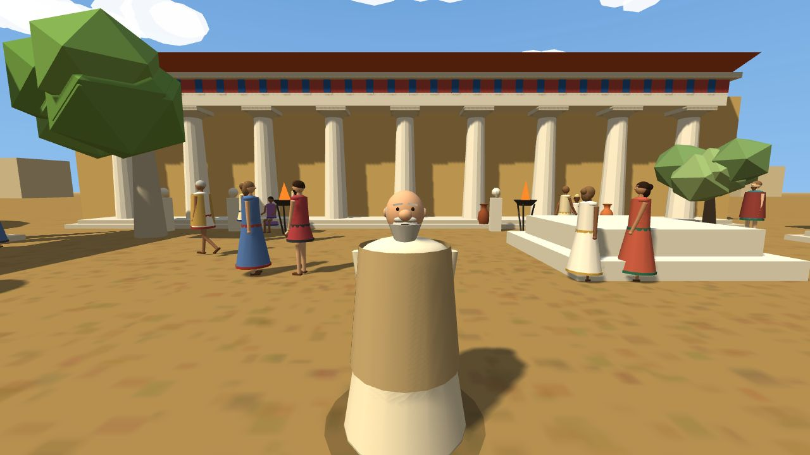
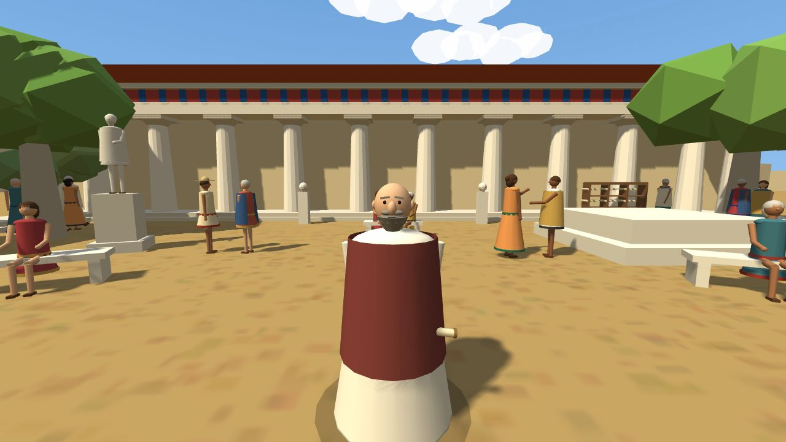
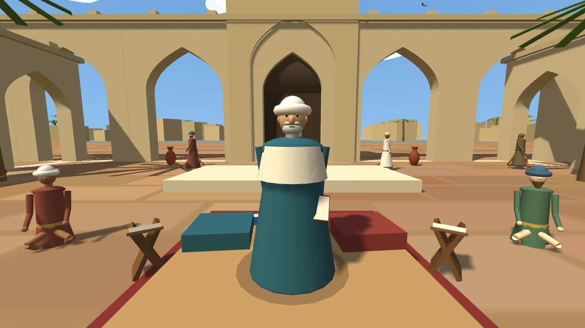

# 3B Mekânlar: Sokrates, Aristoteles, Farabi (WebXR)

Tek dosyalık (`dist/agora_vr.html`, ~635 KB), **çevrimdışı** çalışan 3B sahne: Antik Atina agorası, Sokrates, Türkçe sesli okuma ve sesli cevap, VR başlığı desteği. Diyalog içeriği `data/dialogues/sokrates_yuz_yuze.json` dosyasından gelir (Word taslağından üretilir).






## Çalıştırma
| Ortam | Nasıl |
|---|---|
| Bilgisayar / telefon | `dist/agora_vr.html`'i Chrome veya Edge'de aç. Sürükleyerek etrafa bak. |
| Streamlit | Menüde **3B Agora (VR)** sayfası. |
| VR başlığı (Quest vb.) | Dosyayı **https** veya `localhost` ile sun (`python -m http.server 8000`, ya da GitHub Pages). Başlık tarayıcısında aç → **VR'ye gir**. WebXR ve mikrofon güvenli bağlam ister; `file://` ile VR çalışmaz. |

VR içinde cevaplar önündeki panelden denetleyici ışınıyla seçilir (tetik = seç).

## Sahne
Boyalı frizli ve kiremit çatılı stoalar, meander kenarlı mermer döşeme, çeşme, heykeller, ateş çanakları, pazar tezgâhı, zeytin ve servi ağaçları, gölgeler, bulutlar, uçan kuşlar, uzakta Akropolis ve beyaz evler. **Vatandaşlar** uzuvlu figürlerdir: yürüyenler (kollar-bacaklar sallanır, rotada dolaşırlar), konuşan çiftler (el hareketi), bankta oturanlar, tezgâhta satıcı; kadın/erkek, farklı ten, saç, sakal, şapka ve pelerin çeşitleri.
- Performans: ~500 çizim çağrısı (masaüstünde akıcı). VR'de gölge kapanır ve kalabalık yarıya iner; zayıf cihazda adrese `?lite` ekleyerek aynı modu açabilirsin. **Quest'te ölçülmedi.**

## Ses
- **Sokrates konuşur (TTS):** tarayıcının `speechSynthesis` API'si, `tr-TR` ses. Cihazda Türkçe ses yoksa yalnızca altyazı gösterilir (düğmenin ipucunda yazar). Ücretsiz, anahtar yok.
- **Sen konuşursun (STT):** `SpeechRecognition` API'si, `tr-TR`, **bas-konuş**. "Evet", "hayır", "bilmiyorum", "yaşadıklarıma dayanıyor", "düşüncem değişti", "konuyu değiştir", "tekrar", "sus" gibi ifadeler tanınır (`src/speech.js` → `KEYWORDS`; ekleyebilirsin).
- **Gizlilik:** Chrome/Edge'de ses tanıma sesi tarayıcı sağlayıcısına gönderebilir. Öğrencilerle (özellikle 18 yaş altı) kullanmadan önce okul/veli izni al; istersen mikrofon düğmesini kaldır, düğmelerle çalışır.
- **Sınır:** Quest Browser'da ses tanıma ve VR içinde ses okuma desteği sürüme göre değişir; denenmedi. Düğme/denetleyici seçimi her zaman çalışır.

## Sokrates modeli
Sahnedeki Sokrates `src/scene.js` içinde **prosedürel** üretilir (cübbe, drape, kel alın, sakal, ağız ve el hareketi, kameraya dönme). Gerçekçi bir model değil, stilize bir yer tutucudur. Daha iyi görünüm için bir 3B sanatçıdan veya lisansı uygun bir glTF modelinden `makeSokrates()` yerine `GLTFLoader` ile yükleme yapılabilir (`data/` altında lisans matrisine işleyin).

## Geliştirme
```bash
python scripts/build_vr.py        # src + three.js + JSON -> dist/agora_vr.html
pytest tests/vr                   # JS/Python parite, sesli komut, derleme, (varsa) tarayıcı testi
```
`vendor/three.min.js` three.js r128'dir (MIT, `THREE_LICENSE.txt`). Tarayıcı testi için isteğe bağlı: `pip install playwright && playwright install chromium`.

## Yapı
`src/dialogue.js` durum makinesi (Python `services/dialogue.py` ile birebir aynı; testle doğrulanır) · `src/speech.js` TTS/STT/komut eşleştirme · `src/scene.js` sahne ve Sokrates · `src/app.js` HUD, VR paneli, VR girişi · `src/template.html` arayüz.
